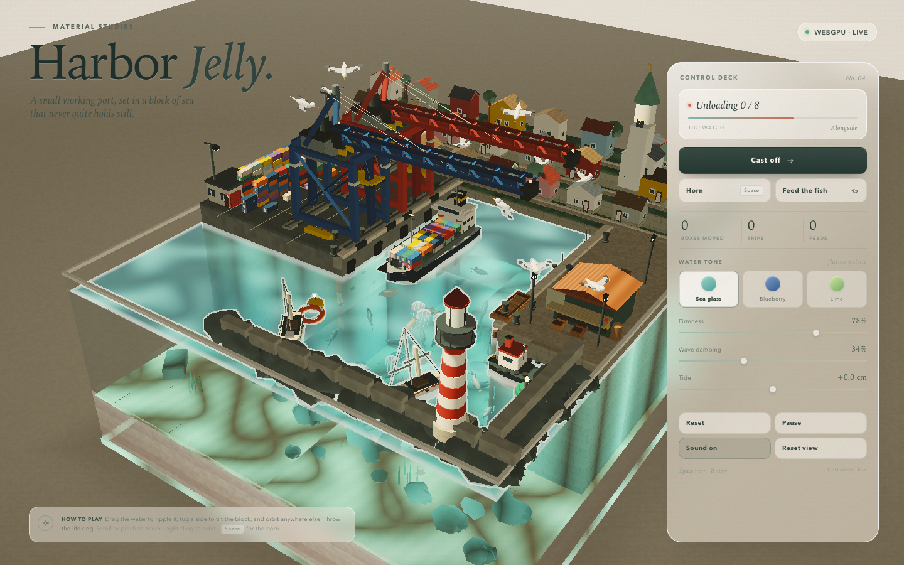

# 果冻码头 · Harbor Jelly

> 一座会呼吸的微型港口，漂浮在一块 5.2 × 5.2 的果冻海里。

**果冻码头**是一个单文件的 WebGPU 互动作品：把一座真实运转的集装箱港口，装进一块不断晃动、会随交互形变的果冻海之中，摆在暖色纸张质感的舞台上。场景里的一切，从海水波动、折射焦散，到集装箱吊运、鱼群游动、海鸥起落，全部由程序生成，不使用任何外部图片、字体、音频或第三方库。

## 快速开始

用支持 WebGPU 的浏览器直接打开 `index.html` 即可，推荐开启硬件加速的 Chrome、Edge 或 Safari。页面不会发起任何网络请求。手机上控制面板会收成底部抽屉。

## 怎么玩

- 拖动水面产生涟漪，拖动果冻块的边缘会让整个场景倾斜，果冻随之剪切并回弹。
- 拖动空白处或右键拖动旋转视角，滚轮或双指缩放。
- 港口会自己跑一套约 100 秒的循环：卸货、装货、拖轮牵引、航行、返港、靠泊，周而复始。你也可以手动"提前离港""召回船只""鸣笛""喂鱼""投掷救生圈"。
- 侧栏可以切换海水色调（海玻璃、蓝莓、青柠），调节果冻的硬度、波浪阻尼和潮位。

## 技术与运行

- 打开作品无需构建。运行测试需要先执行 `npm install`，再用 `npm test` 跑无头逻辑测试，`npm run test:e2e` 跑 Playwright 端到端测试。
- 最终成品是单个 HTML 文件，内联 CSS、逻辑内核、应用代码与 WGSL 着色器。`src/` 是可读源码，`build.mjs` 负责把它们合并进 `index.html`。
- 确定性的港口时间线放在纯 JavaScript 内核里，可以脱离浏览器单独测试；渲染层不自行决定剧情。

---

# English

**Material Studies — Harbor Jelly.** A single-file, self-contained WebGPU diorama of a small working container port, set inside a 5.2 × 5.2 block of wobbling jelly ocean on a warm paper studio stage.

Open **index.html** in a current WebGPU browser (Chrome, Edge or Safari on a machine with hardware acceleration). The page makes **no external requests** and uses no third-party libraries.

## The little world

- A live linear shallow-water simulation on a staggered grid — cell-centre heights, face velocities, a touch of surface tension, firmness and damping controls, tide.
- Refracted water, depth absorption, a caustic pass, projected caustics, warm studio Fresnel reflection, foam, shoreline lace, ship wakes and a bright cut-edge meniscus.
- A container terminal with two rail-mounted ship-to-shore cranes, roughly 250 GPU-instanced containers in ten paint schemes, a quay wall with fenders and mussels, a light tower, an office and neat yard markings.
- A stone fishing quay with a cobbled apron, a corrugated seafood market, lamps, a timber jetty on mussel-covered piles, and two moored fishing boats.
- A three-row Nordic port town on a grassy slope: gabled houses in falu red, ochre, bone, light blue, mint and pink, slate/tile roofs, a white church with a copper spire, round-canopy trees.
- A rock breakwater with a concrete parapet and a compact red-and-white lighthouse whose lens turns slowly.
- Open water with two sailing dinghies, yellow mooring buoys, and a green channel buoy.
- A seabed with rippled sand, eelgrass, rocks, starfish, an old anchor with chain, and a lost tyre.
- Fish schools (mackerel, herring, orange wrasse) using boids, avoiding boats and fleeing splashes; moon jellies with pulsing bells and tentacles; gulls that fly, glide, land on moving perches, and dive for food.
- A fully automatic ~100 second port day: unload, load, raise booms, tug pulls the bow, sail the basin, return, berth and repeat. Cast off early, call the ship home, sound the horn, feed the fish, throw the life ring.

## Controls

- **Drag water** — crosshair appears; drag to make ripples.
- **Drag a side of the jelly block** — tilt the whole diorama; water sloshes, jelly shears and recovers.
- **Drag empty space / right-drag** — orbit. **Wheel / pinch** — zoom.
- **Cast off / Call her in** — early departure or early return.
- **Horn** — synthesized two-reed ship horn, steam, and all gulls take flight. Also Space.
- **Feed the fish** — pellets at the jetty; fish rush in, gulls dive.
- **Water tone** — Sea glass / Blueberry / Lime changes the sea, refraction and the candy strata tint.
- **Firmness / Wave damping / Tide** — change the jelly-water response and the water level.
- **Reset / Pause / Sound on-off / Reset view** — R resets the camera.
- Orange-and-white **life ring** — pick it up from the water and throw it; it floats, bounces off the quay, jetty and breakwater, and is pushed by the working vessels.

The UI is light-theme only. On phones the control panel becomes a collapsible bottom drawer.

## Run + test

No build step is needed to view the deliverable. For the test suites:

    npm install
    npm test            # headless deterministic choreography / collision tests
    npm run test:e2e    # Playwright end-to-end tests (Chrome + WebGPU)

The headless suite extracts the pure, embedded choreography core from index.html and runs it under Node. It checks:

- a full ~100 s shift, eight container transfers and trip accounting;
- no ship/land, ship/vessel, tug/land, tug/vessel or crane-gap collisions;
- early Cast off behaviour (finish the carried box, skip the rest);
- accelerated Call her in and a clean return path.

The Playwright suite verifies WebGPU live status and draw counts, later voyage stages, all panel controls, sliders/palettes/stats/reset, orbit and wheel camera input, water ripples, side-drag tilt, life-ring throw, no page scroll, no console errors, no external requests, the mobile drawer, reduced motion, and the friendly WebGPU-absent fallback.

## Technical notes

- The built page is one HTML file: inline CSS, inline choreography core, inline application and WGSL. It uses system fonts and data-URI noise only.
- Render order: caustic tile → 2048² sun shadow map → HDR opaque scene + eye-distance buffer → jelly-water cut faces and surface (sampling a copy of the scene, with a manual distance-buffer occlusion test) → ACES tone map + grade + dither.
- Moving machinery is authored as static vertex buffers with an object id per vertex. 24 object transforms live in a uniform buffer. Cables (crane hoists, forestays, towline) are dynamic line segments between transformed endpoints.
- Props share one WGSL material system: matte paint, glass, glossy metal, roof tiles, wood grain, corrugated steel, ashlar, rubber, rock, emissive lamps, swaying weed and anti-fouling hull paint.
- Containers are a single instanced draw with up to ten paint schemes; fish, gulls, moon jellies and particles are also instanced.
- The deterministic port timeline lives in a small pure-JS core so it can be tested without a browser. The rendering and UI layer never decides choreography on its own.
- The browser frame loop keeps a fixed 60 Hz choreography step and measures the simulation + life update pass. On the build/test machine it sits around 0.8–1.3 ms per frame, well inside the ~2 ms simulation budget.

## Project layout

- index.html — the complete self-contained deliverable.
- src/ — readable sources used to generate the single file (shell.html, plain JS modules, WGSL).
- build.mjs — inlines src/ into index.html (npm run build).
- test/choreography.test.mjs — headless Node simulation tests.
- test/e2e/harbor.spec.mjs — Playwright interaction tests.
- screenshots/ — final visual documentation.

All geometry, textures, motion and audio are procedural. There are no image, font, audio, script or network dependencies.
